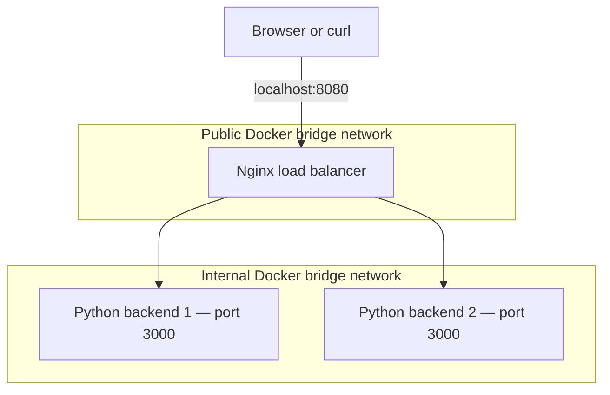

# Week 2 — Architecture Review

**Project:** Docker Network Load Balancer  
**Existing repository:** https://github.com/Bustervro/week03-network-loadbalancer

## Goal

For Week 2, I am continuing my existing Docker network load balancer project. I am reviewing its architecture instead of creating a new application.

## Simple description

A browser or `curl` sends a request to Nginx. Nginx is the public entry point and passes requests to two Python backend servers. The backends are inside a private Docker network and do not publish ports directly to the host. The server that receives the request responds through Nginx.

## Architecture diagram



## Architecture style and components

This is a **containerized, multi-tier reverse-proxy architecture** with Nginx handling incoming traffic and two backend instances serving responses. It demonstrates distributing requests and isolating backend services. It is not a complete cloud deployment or an independent microservice system.

| Component | Job |
|---|---|
| Browser / curl | Sends HTTP requests |
| Nginx | Accepts public HTTP requests and routes them to available backends |
| Backend 1 and backend 2 | Return a simple HTTP/JSON response, including server identity |
| Public Docker network | Gives the Nginx container an entry network |
| Internal Docker network | Connects Nginx to backends without publishing backend host ports |

## Review findings and trade-offs

1. **Strength:** Only Nginx needs a published host port; backend ports stay private to Docker.
2. **Strength:** Using two backends makes load distribution and basic failover possible.
3. **Limit:** The local demo does not by itself provide production TLS, cloud VPC security groups, or highly available Nginx.
4. **Limit:** In-memory work or data would not automatically be shared between the two backends. The current example is intentionally simple.
5. **Next improvement:** Run and record actual balancing, health-check, and failover results, then document what happened.

## How to check the architecture locally

> These commands require Docker Desktop / Docker Engine and Docker Compose. Run them in the folder containing `docker-compose.yml`.

```bash
docker compose up --build -d
docker compose ps
curl -i http://localhost:8080/healthz
```

Verify which services expose host ports using `docker compose ps`. If it matches the intended configuration, only Nginx publishes port 8080.

## AI assistance and verification

ChatGPT helped organize this architecture review. I based the description on the project's earlier README documentation. I still need to compare each statement with the current `docker-compose.yml`, `nginx.conf`, and Python source before claiming a completed code audit. I have not represented unrun tests as passing.

## Week 2 evidence to add

- [ ] Screenshot of the GitHub architecture file
- [ ] Screenshot of current Docker Compose file / service definitions
- [ ] Link to the Week 2 issue, if required by the course
- [ ] Link to my Week 2 branch and draft pull request, once created

Week 2 update: Reviewed the Nginx load balancer architecture and documented its components, strengths, and limitations.
